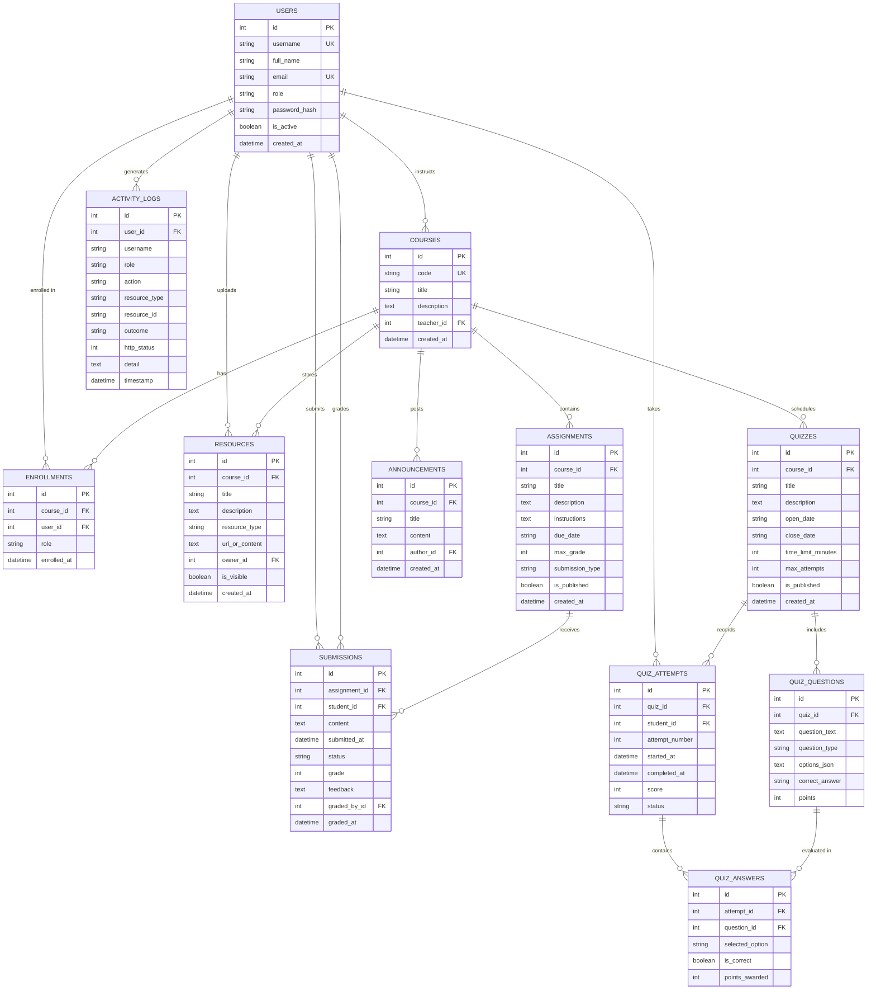

# Database Schema: GuardSLM Research LMS

## 1. Relational Entity Relationship Diagram

---

## 2. Table Specifications

### 2.1 `users`
Stores authenticated personas for benchmark experiments.

| Column | Type | Constraints | Description |
|---|---|---|---|
| `id` | `INTEGER` | Primary Key, Auto-increment | Unique identifier |
| `username` | `VARCHAR(50)` | UNIQUE, NOT NULL, Indexed | Login username |
| `full_name` | `VARCHAR(120)` | NOT NULL | Display name |
| `email` | `VARCHAR(120)` | UNIQUE, NOT NULL | Institutional email |
| `role` | `VARCHAR(30)` | NOT NULL, Indexed | Role: `admin`, `teacher`, `student` |
| `password_hash` | `VARCHAR(255)` | NOT NULL | Bcrypt salted hash |
| `is_active` | `BOOLEAN` | DEFAULT TRUE, NOT NULL | Account login authorization flag |
| `created_at` | `TIMESTAMP` | UTC timestamp | Record creation timestamp |

### 2.2 `courses`
Academic courses representing curricular boundaries.

| Column | Type | Constraints | Description |
|---|---|---|---|
| `id` | `INTEGER` | Primary Key, Auto-increment | Unique identifier |
| `code` | `VARCHAR(20)` | UNIQUE, NOT NULL, Indexed | Course code (e.g., `CS101`, `HUM244`) |
| `title` | `VARCHAR(150)` | NOT NULL | Course title |
| `description` | `TEXT` | NOT NULL | Course syllabus and summary |
| `teacher_id` | `INTEGER` | FK `users.id`, ON DELETE SET NULL | Assigned faculty instructor |
| `created_at` | `TIMESTAMP` | UTC timestamp | Creation date |

### 2.3 `enrollments`
Join table defining which students are authorized to access which course fixtures.

| Column | Type | Constraints | Description |
|---|---|---|---|
| `id` | `INTEGER` | Primary Key, Auto-increment | Unique identifier |
| `course_id` | `INTEGER` | FK `courses.id`, ON DELETE CASCADE | Target course |
| `user_id` | `INTEGER` | FK `users.id`, ON DELETE CASCADE | Enrolled user |
| `role` | `VARCHAR(30)` | DEFAULT `'student'` | Course context role |
| `enrolled_at` | `TIMESTAMP` | UTC timestamp | Date of registration |

*Unique Constraint*: `uq_course_user_enrollment` on `(course_id, user_id)`.

### 2.4 `assignments`
Coursework deliverables with grading criteria and deadlines.

| Column | Type | Constraints | Description |
|---|---|---|---|
| `id` | `INTEGER` | Primary Key, Auto-increment | Unique identifier |
| `course_id` | `INTEGER` | FK `courses.id`, ON DELETE CASCADE | Parent course |
| `title` | `VARCHAR(150)` | NOT NULL | Assignment name |
| `description` | `TEXT` | NOT NULL | Overview of expectations |
| `instructions` | `TEXT` | NOT NULL | Detailed submission requirements |
| `due_date` | `VARCHAR(40)` | NOT NULL | Scheduled deadline date |
| `max_grade` | `INTEGER` | DEFAULT 100, NOT NULL | Total attainable points |
| `submission_type` | `VARCHAR(30)` | DEFAULT `'text'` | Mode of submission |
| `is_published` | `BOOLEAN` | DEFAULT TRUE, NOT NULL | Availability flag |
| `created_at` | `TIMESTAMP` | UTC timestamp | Creation date |

### 2.5 `submissions`
Student deliverable submissions and faculty evaluation records.

| Column | Type | Constraints | Description |
|---|---|---|---|
| `id` | `INTEGER` | Primary Key, Auto-increment | Unique identifier |
| `assignment_id` | `INTEGER` | FK `assignments.id`, ON DELETE CASCADE | Parent assignment |
| `student_id` | `INTEGER` | FK `users.id`, ON DELETE CASCADE | Submitting student |
| `content` | `TEXT` | NOT NULL | Solution body / text submission |
| `submitted_at` | `TIMESTAMP` | UTC timestamp | Submission timestamp |
| `status` | `VARCHAR(30)` | DEFAULT `'submitted'` | State: `submitted`, `graded` |
| `grade` | `INTEGER` | Nullable | Score awarded (0-100) |
| `feedback` | `TEXT` | Nullable | Instructor critique notes |
| `graded_by_id` | `INTEGER` | FK `users.id`, ON DELETE SET NULL | Instructor who evaluated |
| `graded_at` | `TIMESTAMP` | Nullable | Evaluation timestamp |

*Unique Constraint*: `uq_assignment_student_submission` on `(assignment_id, student_id)`.

### 2.6 `quizzes`
Multiple-choice assessments with attempt policies.

| Column | Type | Constraints | Description |
|---|---|---|---|
| `id` | `INTEGER` | Primary Key, Auto-increment | Unique identifier |
| `course_id` | `INTEGER` | FK `courses.id`, ON DELETE CASCADE | Parent course |
| `title` | `VARCHAR(150)` | NOT NULL | Assessment name |
| `description` | `TEXT` | NOT NULL | Assessment overview |
| `open_date` | `VARCHAR(40)` | NOT NULL | Opening availability window |
| `close_date` | `VARCHAR(40)` | NOT NULL | Closing availability window |
| `time_limit_minutes` | `INTEGER` | DEFAULT 30, NOT NULL | Timed duration |
| `max_attempts` | `INTEGER` | DEFAULT 1, NOT NULL | Attempt ceiling enforced by backend |
| `is_published` | `BOOLEAN` | DEFAULT TRUE, NOT NULL | Publication status |
| `created_at` | `TIMESTAMP` | UTC timestamp | Creation date |

### 2.7 `quiz_questions`
Assessment items with automated grading keys.

| Column | Type | Constraints | Description |
|---|---|---|---|
| `id` | `INTEGER` | Primary Key, Auto-increment | Unique identifier |
| `quiz_id` | `INTEGER` | FK `quizzes.id`, ON DELETE CASCADE | Parent quiz |
| `question_text` | `TEXT` | NOT NULL | Prompt text |
| `question_type` | `VARCHAR(30)` | DEFAULT `'multiple_choice'` | Question format |
| `options_json` | `TEXT` | NOT NULL | JSON array of option strings |
| `correct_answer` | `VARCHAR(100)` | NOT NULL | Correct option string |
| `points` | `INTEGER` | DEFAULT 10, NOT NULL | Weight per question |

### 2.8 `quiz_attempts`
Student test-taking attempts and calculated scores.

| Column | Type | Constraints | Description |
|---|---|---|---|
| `id` | `INTEGER` | Primary Key, Auto-increment | Unique identifier |
| `quiz_id` | `INTEGER` | FK `quizzes.id`, ON DELETE CASCADE | Evaluated quiz |
| `student_id` | `INTEGER` | FK `users.id`, ON DELETE CASCADE | Student user |
| `attempt_number` | `INTEGER` | DEFAULT 1, NOT NULL | Sequence index of attempt |
| `started_at` | `TIMESTAMP` | UTC timestamp | Start timestamp |
| `completed_at` | `TIMESTAMP` | Nullable | Final submission timestamp |
| `score` | `INTEGER` | Nullable | Normalized score (0-100) |
| `status` | `VARCHAR(30)` | DEFAULT `'finished'` | State: `in_progress`, `finished` |

### 2.9 `resources`
Curriculum documents, lecture slides, and supplementary links.

| Column | Type | Constraints | Description |
|---|---|---|---|
| `id` | `INTEGER` | Primary Key, Auto-increment | Unique identifier |
| `course_id` | `INTEGER` | FK `courses.id`, ON DELETE CASCADE | Parent course |
| `title` | `VARCHAR(150)` | NOT NULL | Document title |
| `description` | `TEXT` | NOT NULL | Overview of resource |
| `resource_type` | `VARCHAR(30)` | DEFAULT `'document'` | Document, slides, pdf, link |
| `url_or_content` | `TEXT` | NOT NULL | External link or path |
| `owner_id` | `INTEGER` | FK `users.id`, ON DELETE SET NULL | Author user ID |
| `is_visible` | `BOOLEAN` | DEFAULT TRUE, NOT NULL | Student visibility flag |
| `created_at` | `TIMESTAMP` | UTC timestamp | Creation date |

### 2.10 `activity_logs`
Research observability telemetry capturing every access decision.

| Column | Type | Constraints | Description |
|---|---|---|---|
| `id` | `INTEGER` | Primary Key, Auto-increment | Unique identifier |
| `user_id` | `INTEGER` | FK `users.id`, Nullable | Authenticated user |
| `username` | `VARCHAR(50)` | Nullable | Cached username |
| `role` | `VARCHAR(30)` | Nullable | Persona role at execution |
| `action` | `VARCHAR(50)` | NOT NULL | Action (e.g. `VIEW_COURSE`, `GRADE`) |
| `resource_type` | `VARCHAR(50)` | NOT NULL | Target entity type |
| `resource_id` | `VARCHAR(50)` | Nullable | Target entity ID |
| `outcome` | `VARCHAR(20)` | NOT NULL | Decision: `ALLOW` or `BLOCK` |
| `http_status` | `INTEGER` | NOT NULL | HTTP status code (200, 201, 401, 403, 404) |
| `detail` | `TEXT` | NOT NULL | Diagnostic rationale |
| `timestamp` | `TIMESTAMP` | UTC timestamp | Decision timestamp |

---

## 3. Seeded Data Inventory

### 3.1 Users
| ID | Username | Role | Full Name | Email | Password |
|---|---|---|---|---|---|
| 1 | `admin` | Administrator | Site Administrator | `admin@guardslm.edu` | `GuardSLM2026!` |
| 2 | `teacher1` | Teacher | Dr. Aditi Sharma | `aditi.sharma@guardslm.edu` | `GuardSLM2026!` |
| 3 | `teacher2` | Teacher | Prof. Rahul Mehta | `rahul.mehta@guardslm.edu` | `GuardSLM2026!` |
| 4 | `student1` | Student | Aarav Singh | `aarav.singh@guardslm.edu` | `GuardSLM2026!` |
| 5 | `student2` | Student | Meera Iyer | `meera.iyer@guardslm.edu` | `GuardSLM2026!` |
| 6 | `student3` | Student | Kabir Khan | `kabir.khan@guardslm.edu` | `GuardSLM2026!` |

### 3.2 Courses & Enrolments
- **CS101**: Introduction to Computer Science
  - Instructor: `teacher1` (ID: 2)
  - Enrolled Students: `student1` (ID: 4), `student2` (ID: 5)
- **HUM244**: Technology and Society
  - Instructor: `teacher2` (ID: 3)
  - Enrolled Students: `student2` (ID: 5), `student3` (ID: 6)

### 3.3 Assignments, Submissions & Initial Grades
- **Programming Assignment 1** (CS101):
  - student1: 88 / 100 (Graded by Dr. Aditi Sharma)
  - student2: 92 / 100 (Graded by Dr. Aditi Sharma)
- **Research Reflection** (CS101):
  - student1: Submitted, Ungraded
- **Technology Ethics Essay** (HUM244):
  - student2: 76 / 100 (Graded by Prof. Rahul Mehta)
  - student3: 84 / 100 (Graded by Prof. Rahul Mehta)

### 3.4 Quizzes & Attempt Quotas
- **CS101 Practice Quiz**: Max Attempts: 3
  - student1: Attempt 1 (90%), Attempt 2 (95%)
  - student2: Attempt 1 (82%)
  - Total Seeded Attempts: 3
- **CS101 Graded Quiz**: Max Attempts: 1
  - student1: Attempt 1 (85%) — Attempt quota reached! Retake blocked by backend.
  - Total Seeded Attempts: 1
- **HUM244 Reading Quiz**: Max Attempts: 2
  - student2: Attempt 1 (78%)
  - student3: Attempt 1 (85%)
  - Total Seeded Attempts: 2
