# Database Schema: GuardSLM Academic LMS

This document specifies the authoritative relational schema, table structures, constraints, and seeded data inventory for the GuardSLM LMS research testbed.

The database runs on embedded SQLite (with fallback support for PostgreSQL) and enforces active relational integrity via `PRAGMA foreign_keys = ON` on all connections.

---

## 1. Relational Entity Relationship Diagram

```mermaid
erDiagram
    USERS ||--o{ ENROLLMENTS : "maintains"
    USERS ||--o{ COURSES : "instructs"
    USERS ||--o{ SUBMISSIONS : "submits"
    USERS ||--o{ QUIZ_ATTEMPTS : "takes"
    USERS ||--o{ ACTIVITY_LOGS : "generates"
    USERS ||--o{ GROUP_MEMBERS : "belongs to"
    USERS ||--o{ DISCUSSION_POSTS : "authors"
    USERS ||--o{ COURSE_FILES : "uploads"
    USERS ||--o{ PEER_REVIEWS : "reviews"
    USERS ||--o{ GRADE_APPEALS : "files"
    USERS ||--o{ ATTENDANCE_RECORDS : "records"

    DEPARTMENTS ||--o{ COURSES : "offers"
    COURSES ||--o{ ENROLLMENTS : "enrolls"
    COURSES ||--o{ COURSE_SECTIONS : "divides into"
    COURSES ||--o{ ASSIGNMENTS : "contains"
    COURSES ||--o{ QUIZZES : "schedules"
    COURSES ||--o{ RESOURCES : "stores"
    COURSES ||--o{ ANNOUNCEMENTS : "broadcasts"
    COURSES ||--o{ GROUPS : "hosts"
    COURSES ||--o{ DISCUSSION_THREADS : "features"
    COURSES ||--o{ LEARNING_MODULES : "organizes"
    COURSES ||--o{ COURSE_FILES : "indexes"
    COURSES ||--o{ ATTENDANCE_SESSIONS : "schedules"

    COURSE_SECTIONS ||--o{ ENROLLMENTS : "assigns"
    COURSE_SECTIONS ||--o{ ATTENDANCE_SESSIONS : "conducts"

    ASSIGNMENTS ||--o{ SUBMISSIONS : "receives"
    ASSIGNMENTS ||--o{ GRADE_HISTORIES : "tracks"
    SUBMISSIONS ||--o{ PEER_REVIEWS : "reviewed in"
    SUBMISSIONS ||--o{ GRADE_APPEALS : "appealed in"
    SUBMISSIONS ||--o{ GRADE_HISTORIES : "logs score change"

    QUIZZES ||--o{ QUIZ_QUESTIONS : "includes"
    QUIZZES ||--o{ QUIZ_ATTEMPTS : "records"
    QUIZ_ATTEMPTS ||--o{ QUIZ_ANSWERS : "contains"
    QUIZ_QUESTIONS ||--o{ QUIZ_ANSWERS : "evaluated against"

    GROUPS ||--o{ GROUP_MEMBERS : "includes"
    GROUPS ||--o{ SUBMISSIONS : "group submissions"

    DISCUSSION_THREADS ||--o{ DISCUSSION_POSTS : "contains"
    DISCUSSION_POSTS ||--o{ DISCUSSION_POSTS : "replies to (parent_post_id)"
    DISCUSSION_POSTS ||--o{ DISCUSSION_MODERATION_LOGS : "moderated in"

    LEARNING_MODULES ||--o{ LESSONS : "delivers"
    LEARNING_MODULES ||--o{ STUDENT_MODULE_PROGRESS : "tracked in"
    ATTENDANCE_SESSIONS ||--o{ ATTENDANCE_RECORDS : "contains"
```

---

## 2. Table Catalog (28 Relational Models)

### Core Authentication & Institutional Foundation
1. **`users`**: Global accounts (`admin01`, `admin02`, `prof01`-`prof04`, `ta01`-`ta08`, `student01`-`student40`). Stores `username`, `email`, `role`, `password_hash`, and `is_active`.
2. **`departments`**: Academic units (`CS`, `EE`, `HCI`, `DS`) with `code`, `name`, `chair_name`, and `building`.
3. **`courses`**: Course offerings (`CSE301`, `CSE302`, `CSE303`, `HCI401`) with `code`, `title`, `description`, `teacher_id` (FK to `users.id`), `department_id`, and `is_archived`.
4. **`course_sections`**: Section subdivisions (`SEC01`, `SEC02`) with `section_code`, `room`, `meeting_times`, `capacity`, and `term`.
5. **`enrollments`**: Course memberships linking `user_id`, `course_id`, `section_id`, `role` (`student`, `ta`, `professor`), `status` (`active`, `suspended`, `revoked`), and `enrolled_at`.
6. **`groups`**: Collaborative teams within a course (`course_id`, `name`, `max_members`).
7. **`group_members`**: Membership table linking `group_id` and `user_id`.

### Coursework & Assessment Engine
8. **`assignments`**: Assessment specifications (`course_id`, `title`, `description`, `instructions`, `due_date`, `max_grade`, `submission_type`, `is_group`, `allow_late`, `is_published`, `is_archived`).
9. **`submissions`**: Student hand-ins (`assignment_id`, `student_id`, `group_id`, `content`, `submitted_at`, `status`, `grade`, `feedback`, `graded_by_id`, `graded_at`, `is_published`, `is_draft`, `extension_granted`).
10. **`quizzes`**: Timed tests (`course_id`, `title`, `description`, `open_date`, `close_date`, `answer_release_date`, `time_limit_minutes`, `max_attempts`, `is_published`, `is_archived`).
11. **`quiz_questions`**: Assessment questions (`quiz_id`, `question_text`, `question_type`, `options_json`, `correct_answer`, `points`).
12. **`quiz_attempts`**: Student test sessions (`quiz_id`, `student_id`, `attempt_number`, `started_at`, `completed_at`, `score`, `status`).
13. **`quiz_answers`**: Student item selections (`attempt_id`, `question_id`, `selected_option`, `is_correct`, `points_awarded`).

### Learning Modules & Repository
14. **`learning_modules`**: Sequential course units (`course_id`, `title`, `description`, `order_index`, `unlock_at`, `is_published`, `prerequisite_module_id`).
15. **`lessons`**: Instructional content items (`module_id`, `title`, `content`, `order_index`, `duration_minutes`).
16. **`student_module_progress`**: Learner completion records (`user_id`, `module_id`, `is_completed`, `completed_at`).
17. **`course_files`**: Uploaded repository assets (`course_id`, `uploader_id`, `filename`, `storage_path`, `file_size`, `mime_type`, `access_level`, `group_id`, `is_archived`, `created_at`).
18. **`resources`**: Supplemental reference links (`course_id`, `title`, `description`, `resource_type`, `url_or_content`, `owner_id`, `is_visible`).

### Discussions & Community
19. **`discussion_threads`**: Forum topics (`course_id`, `author_id`, `recipient_id`, `title`, `visibility_level`, `is_pinned`, `is_locked`, `created_at`).
20. **`discussion_posts`**: Thread entries (`thread_id`, `author_id`, `parent_post_id`, `content`, `is_flagged`, `created_at`, `updated_at`).
21. **`discussion_moderation_logs`**: Staff audit trail of forum actions (`post_id`, `moderator_id`, `action`, `reason`, `timestamp`).

### Peer Review & Grading Governance
22. **`peer_reviews`**: Double-blind review assignments (`submission_id`, `reviewer_id`, `score`, `feedback`, `status`, `assigned_at`, `submitted_at`).
23. **`grade_appeals`**: Student grade contestations (`submission_id`, `student_id`, `reason`, `proposed_score`, `status`, `decision_rationale`, `reviewed_by_id`, `resolved_at`).
24. **`grade_histories`**: Immutable audit logs of all score modifications (`submission_id`, `modifier_id`, `previous_grade`, `new_grade`, `reason`, `modified_at`).

### Attendance & Scheduling
25. **`attendance_sessions`**: Scheduled class meetings (`course_section_id`, `session_date`, `start_time`, `end_time`, `room`, `is_locked`).
26. **`attendance_records`**: Student session participation (`session_id`, `course_section_id`, `student_id`, `status`, `excuse_reason`, `recorded_by_id`, `recorded_at`).

### Announcements & Research Telemetry
27. **`announcements`**: Broadcast messages (`course_id`, `author_id`, `title`, `content`, `is_pinned`, `created_at`).
28. **`activity_logs`**: Research telemetry recording access decisions (`user_id`, `username`, `role`, `action`, `resource_type`, `resource_id`, `outcome`, `http_status`, `detail`, `timestamp`).

---

## 3. Seeded Data Inventory

### 3.1 54 Personas & Credentials
All accounts authenticate with standard credentials:
`Password: GuardSLM2026!`

- **Administrators (2)**: `admin01` (Elena Vance), `admin02` (Marcus Brody).
- **Professors (4)**: `prof01` (Dr. Mira Shah), `prof02` (Dr. Jonathan Cole), `prof03` (Dr. Evelyn Reed), `prof04` (Dr. Warren Hastings).
- **Teaching Assistants (8)**: `ta01` (Sam Lee), `ta02` (Rachel Green), `ta03` (Devon Vance), `ta04` (Chloe Bennett), `ta05` (Lucas Silva), `ta06` (Zoe Adams), `ta07` (Tariq Mansoor), `ta08` (Elena Rostova).
- **Students (40)**: `student01` (Asha Mehta) through `student40` (Nia Patel).

### 3.2 Academic Courses & Cross-Enrollment Scenarios
- **`CSE301` — Database Systems**:
  - Instructor: `prof01`
  - TAs: `ta01`, `ta02`
  - Sections: `SEC01`, `SEC02`
- **`CSE302` — Computer Networks**:
  - Instructor: `prof02`
  - TAs: `ta03`, `ta04`
  - Cross-Enrolled TA: `ta01` is enrolled as a **Student** in `CSE302`.
- **`CSE303` — Distributed Systems**:
  - Instructor: `prof01`
  - TAs: `ta05`, `ta06`
- **`HCI401` — User Interface Design**:
  - Instructor: `prof02`
  - TAs: `ta07`, `ta08`

---

## 4. Migration & Schema Synchronization Utility

The repository includes [`backend/app/migrate_db.py`](file:///home/regenesis/Desktop/guard-slm-lms/backend/app/migrate_db.py).
It automatically compares existing SQLite databases against all 28 SQLAlchemy declarative models, dynamically creating missing tables and executing `ALTER TABLE ... ADD COLUMN` statements without dropping data or breaking existing academic records.

It is automatically executed on application startup via FastAPI lifespan context in [`main.py`](file:///home/regenesis/Desktop/guard-slm-lms/backend/app/main.py).
