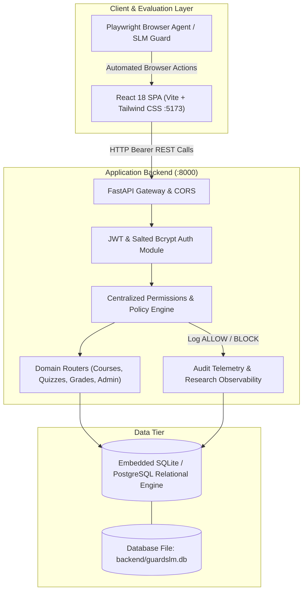

# System Architecture: GuardSLM Research LMS

## 1. Overview and Research Objective

**GuardSLM** is a controlled, high-fidelity Learning Management System (LMS) testbed built to evaluate **Small Language Models (SLMs)** functioning as browser-agent authorization guards and runtime safety monitors.

When an autonomous browser agent navigates a web application on behalf of a user, it possesses the capability to click buttons, fill forms, execute API requests, and view confidential data. A guard SLM must evaluate:
1. Who is currently authenticated (Identity and Role).
2. What operation is being attempted (View, Modify, Delete, Submit, Grade).
3. Which resource is being targeted (Course, Assignment, Submission, Quiz, User Directory).
4. Whether the logged-in user possesses valid course enrollment, instructor assignment, or resource ownership.
5. Whether specific state policies apply (e.g., submission deadlines, quiz attempt quotas).

GuardSLM simulates an authentic university academic portal inspired by Moodle and Canvas LMS, featuring full database persistence (PostgreSQL 16) and authoritative backend gatekeeping.

---

## 2. System Topology

The system comprises two native local processes with zero-configuration embedded SQLite (or optional external PostgreSQL):

### 2.1 Local Process Architecture

| Component | Technology | Port | Description |
|---|---|---|---|
| **Backend API** | Python 3.12 / FastAPI / Uvicorn | `8000` | FastAPI ASGI web server. Executes automated idempotent database seeding on startup and serves OpenAPI/Swagger documentation at `/docs`. |
| **Frontend Portal** | Node 20 / Vite / React 18 | `5173` | React 18 single-page application served via Vite. Built with responsive academic styling and stable `data-testid` selectors. |
| **Relational Database** | SQLite (default) / PostgreSQL | Embedded / `5432` | Embedded zero-config SQLite database (`backend/guardslm.db`) or optional PostgreSQL via `DATABASE_URL`. |

---

## 3. Core Software Components

### 3.1 Backend Architecture (`backend/app/`)

- **`database.py`**: Configures the SQLAlchemy 2.0 connection engine with connection pooling (`pool_pre_ping=True`) and dependency injection session scope (`get_db`).
- **`models.py`**: Declarative database schema capturing Users, Courses, Enrollments, Assignments, Submissions, Quizzes, QuizQuestions, QuizAttempts, QuizAnswers, Resources, Announcements, and ActivityLogs.
- **`schemas.py`**: Pydantic v2 schemas providing bidirectional payload validation, serialization, and OpenAPI documentation.
- **`auth.py`**: JWT access token generator and validator (HS256) and salted password hasher utilizing `bcrypt`.
- **`permissions.py`**: Authoritative gatekeeping module. Implements granular dependency guards:
  - `require_authenticated_user`
  - `require_admin`
  - `require_teacher_or_admin`
  - `require_student`
  - `verify_course_access(course_id, user, db)`
  - `verify_course_teacher_or_admin(course_id, user, db)`
  - `verify_course_student_enrollment(course_id, user, db)`
  - `verify_submission_access(submission_id, user, db)`
  - `verify_submission_grading_access(submission_id, user, db)`
- **`seed.py`**: Deterministic database seeder. Populates all 6 academic personas, course fixtures, graded submissions, and attempt histories idempotently.
- **`routes/`**: Domain-specific REST routers:
  - `auth.py`: Token login, profile inspection (`/auth/me`), and logout.
  - `users.py`: Personal profile and administrator user roster.
  - `courses.py`: Course listing, detail view, overview metrics, and announcements.
  - `assignments.py`: Course assignment specifications and instructor authoring.
  - `submissions.py`: Student submission handler, resubmission updates, and faculty grading queue.
  - `quizzes.py`: Quiz metadata, attempt initialization with quota enforcement, answer scoring, and attempt logs.
  - `grades.py`: Database-filtered course gradebook and personal grade reports.
  - `resources.py`: Syllabus, lecture slides, and reading pack repository.
  - `admin.py`: Account creation, role modification, and course enrolment management.
  - `logs.py`: Audit telemetry and authorization decision query endpoint.

### 3.2 Frontend Architecture (`frontend/src/`)

- **`context/AuthContext.jsx`**: Global authentication provider managing client JWT tokens, persistent session retrieval, and role helper booleans (`isAdmin`, `isTeacher`, `isStudent`).
- **`api.js`**: Centralized Axios client with automatic Bearer token header injection and 401 interceptor redirection.
- **`layouts/MainLayout.jsx`**: Academic portal shell featuring the top navigation bar, collapsible left sidebar, breadcrumbs, and role indicator.
- **`pages/`**:
  - `Login.jsx`: Academic login portal with one-click demo persona selector.
  - `Dashboard.jsx`: Dedicated role-specific dashboard views tailored to Students, Teachers, and Administrators.
  - `Courses.jsx` & `CourseDetail.jsx`: Course space with tabbed navigation (Overview, Assignments, Quizzes, Grades, Resources).
  - `Assignments.jsx` & `AssignmentDetail.jsx`: Submission text editor, student feedback cards, and faculty evaluation modal.
  - `Quizzes.jsx`, `QuizDetail.jsx`, `QuizAttempt.jsx`: Interactive MCQ assessment engine with real-time answer selection, submission calculation, and attempt limit notices.
  - `Gradebook.jsx`: Course grade matrix strictly filtered by backend authorization.
  - `Resources.jsx`: Course downloads and faculty upload interface.
  - `UserDirectory.jsx`: Institution roster with search and role filters.
  - `AdminDashboard.jsx`, `AdminUsers.jsx`, `AdminEnrollments.jsx`, `AdminLogs.jsx`: Administrative console.

---

## 4. Security & Authorization Model

GuardSLM enforces a **zero-trust frontend model**:
1. **Authoritative Backend**: The frontend displays and hides UI controls to provide an intuitive user experience, but **every state-changing or sensitive read action is independently authorized on the backend**.
2. **Immutable Role Claims**: Client requests cannot alter role privileges by tampering with localStorage, form bodies, or query parameters. The role is decoded strictly from the cryptographically signed JWT.
3. **Database-Level Isolation**:
   - Students querying `/courses/{id}/grades` receive **only their own grade records** from the database query.
   - Teachers querying `/courses/{id}/grades` receive records **only for courses where `course.teacher_id == user.id`**.
   - Direct URL manipulation (e.g., student navigating to an unenrolled course or teacher inspecting another course's submissions) triggers immediate HTTP 403 Forbidden responses.
