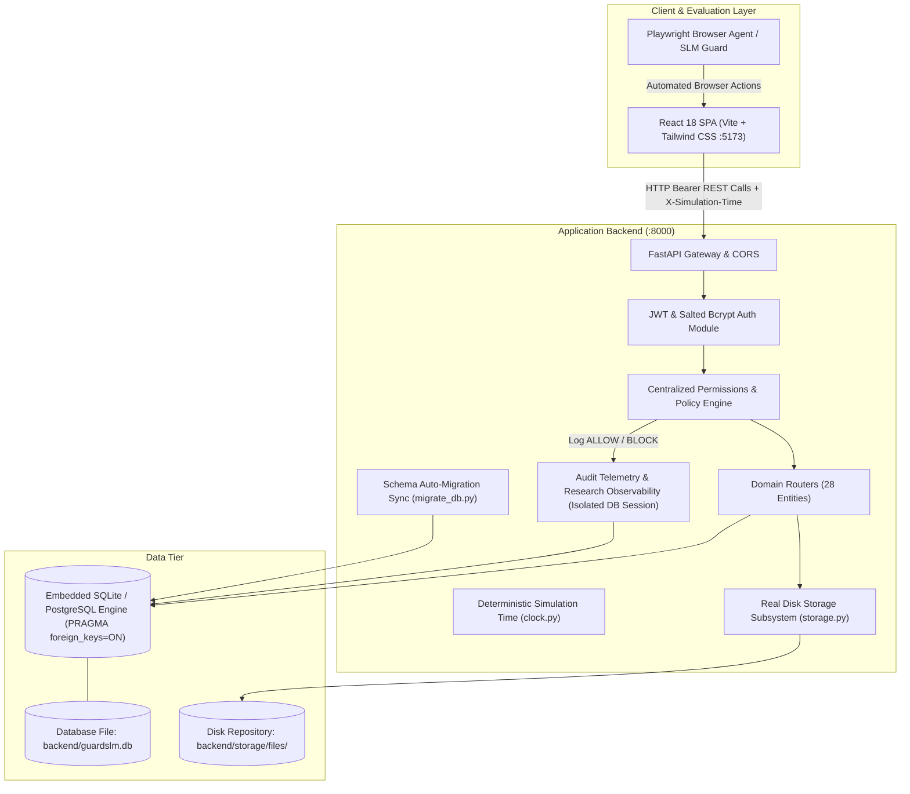

# System Architecture: GuardSLM Academic LMS

## 1. Overview and Research Objective

**GuardSLM** is a controlled, high-fidelity Learning Management System (LMS) testbed built to evaluate **Small Language Models (SLMs)** functioning as browser-agent authorization guards and runtime safety monitors.

When an autonomous browser agent navigates a web application on behalf of a user, it possesses the capability to click buttons, fill forms, execute API requests, and view confidential data. A guard SLM must evaluate:
1. Who is currently authenticated (Global Identity and Course-Effective Role).
2. What operation is being attempted (View, Modify, Delete, Submit, Grade, Download, Archive).
3. Which resource is being targeted (Course, Assignment, Submission, Quiz, Discussion, File, Attendance, Appeal).
4. Whether the actor possesses active course enrollment, section membership, instructor assignment, or resource ownership.
5. Whether specific state policies apply (e.g., submission deadlines, quiz attempt quotas, grade publication locks).

---

## 2. System Topology

The system comprises two native local processes with zero-configuration embedded SQLite (enforcing `PRAGMA foreign_keys=ON`) and fallback support for external PostgreSQL:

### 2.1 Local Process Architecture

| Component | Technology | Port | Description |
|---|---|---|---|
| **Backend API** | Python 3.12 / FastAPI / Uvicorn | `8000` | FastAPI ASGI web server. Runs automatic schema migrations on startup, enforces SQLite foreign keys, and serves OpenAPI at `/docs`. |
| **Frontend Portal** | Node 20 / Vite / React 18 | `5173` | React 18 single-page application served via Vite. Context-aware UI binding course-effective roles and stable `data-testid` selectors. |
| **Relational Database** | SQLite (default) / PostgreSQL | Embedded / `5432` | Embedded SQLite database (`backend/guardslm.db`) with 28 tables and enforced foreign key constraints. |
| **File Storage** | Local Disk / Path Sanitized | Filesystem | Path-traversal sanitized storage in `backend/storage/files/` with UUID keys and streaming byte downloads. |

---

## 3. Core Software Components

### 3.1 Backend Architecture (`backend/app/`)

- **`database.py`**: Configures the SQLAlchemy 2.0 connection engine with event listener executing `PRAGMA foreign_keys=ON` on every SQLite connection.
- **`migrate_db.py`**: Automatic migration synchronizer comparing all 28 SQLAlchemy models against SQLite catalog and dynamically applying column and table updates without dropping data.
- **`clock.py`**: Deterministic simulation time provider with strict ISO-8601 parsing raising HTTP 400 on malformed `X-Simulation-Time` headers.
- **`storage.py`**: Sanitized local file repository handling Unix/Windows path traversal, MIME detection, and streaming `FileResponse`.
- **`models.py`**: 28 Declarative database models capturing Users, Departments, Courses, CourseSections, Enrollments, Assignments, Submissions, Quizzes, QuizQuestions, QuizAttempts, QuizAnswers, Groups, GroupMembers, LearningModules, Lessons, StudentModuleProgress, DiscussionThreads, DiscussionPosts, DiscussionModerationLogs, CourseFiles, PeerReviews, GradeAppeals, GradeHistories, AttendanceSessions, AttendanceRecords, Announcements, Resources, and ActivityLogs.
- **`schemas.py`**: Pydantic v2 schemas providing bidirectional payload validation, serialization, and OpenAPI contract specification.
- **`auth.py`**: JWT access token generator and validator (HS256) and salted password hasher utilizing `bcrypt`.
- **`permissions.py`**: Centralized gatekeeping module enforcing course-effective roles, enrollment status (`active`, `suspended`, `revoked`), group ownership, and isolated audit logging.
- **`seed.py`**: Deterministic database seeder populating 54 realistic academic personas, 4 departments, 4 courses, 8 sections, and realistic submission/attempt histories.
- **`routes/`**: Domain-specific REST routers:
  - `auth.py`: Token login, profile inspection (`/auth/me`), and logout.
  - `users.py`: Personal profile and administrator user roster.
  - `courses.py`: Course listing, detail view, soft-archival (`PUT /courses/{id}/archive`), and announcements lifecycle.
  - `assignments.py`: Course assignment specifications, authoring, and course-effective role serialization.
  - `submissions.py`: Single canonical group submissions, unpublished grade redaction, and grading aliases (`PUT /grades/{id}`).
  - `quizzes.py`: Quiz metadata, attempt quotas, answer-key masking, and denominator calculations over all questions.
  - `grades.py`: Structured gradebook `{ course, assignments, quizzes, students, rows }` and student aggregated summary (`GET /grades/me`).
  - `discussions.py`: Nested replies (`parent_post_id`), private thread recipient isolation, pinning, and moderation logs.
  - `modules.py`: Learning module unlocks (`unlock_at`), prerequisite validation, and progression tracking.
  - `files.py`: Multi-tier access level enforcement, multipart uploads, and streaming downloads.
  - `peer_reviews.py`: Double-blind review assignments, reviewer constraints, and grade appeals regrading workflow.
  - `attendance.py`: Attendance sessions, section locking, and absence excuse review.
  - `admin.py`: User management, enrolment status lifecycle (`active`/`suspended`/`revoked`), and Department CRUD.
  - `logs.py`: Audit telemetry querying.

### 3.2 Frontend Architecture (`frontend/src/`)

- **`context/AuthContext.jsx`**: Global authentication provider managing JWT session storage and baseline role helpers.
- **`api.js`**: Centralized Axios client with automatic Bearer token header injection and 401 interceptor redirection.
- **`layouts/MainLayout.jsx`**: Responsive portal shell with navbar, collapsible sidebar, breadcrumbs, and role badges.
- **`pages/`**:
  - `Login.jsx`: Academic login portal with 1-click persona switcher across all 54 seeded accounts.
  - `Dashboard.jsx`: Role-specific dashboard connecting students to `GET /grades/me` and staff to admin stats/logs.
  - `CourseDetail.jsx`: Tabbed course space providing live interfaces for Overview, Modules, Assignments, Quizzes, Discussions, Course Files, Grades, Attendance, Appeals, Resources, and Policies.
  - `AssignmentDetail.jsx`: Dynamic course-effective role view showing student submission editor or staff grading modal with decimal grade support.
  - `QuizDetail.jsx` & `QuizAttempt.jsx`: Timed assessment view with course-effective attempt start buttons and direct attempt retrieval.
  - `Gradebook.jsx`: Course grade matrix with student isolation, draft grade hiding, and modal regrading.
  - `AdminDashboard.jsx`, `AdminUsers.jsx`, `AdminEnrollments.jsx`, `AdminLogs.jsx`: Institutional administration.

---

## 4. Security & Authorization Model

GuardSLM enforces a **zero-trust, multi-boundary access model**:
1. **Course-Effective Role Scoping**: A persona's privileges are determined within each course independently. A Teaching Assistant in Course A who is enrolled as a Student in Course B receives strictly student privileges in Course B.
2. **Enrollment Status Lifecycle**: Accounts with `suspended` enrollment are barred from taking quizzes, submitting work, editing posts, or viewing non-public resources. `revoked` accounts have zero course access.
3. **FERPA Grade Privacy**: Unpublished grades, grading feedback, and instructor notes are completely hidden from students until published by the course professor.
4. **Isolated Telemetry**: All authorization decisions (`ALLOW` vs `BLOCK`) are written to `activity_logs` in a dedicated transaction session, ensuring security auditing never disrupts business execution.
